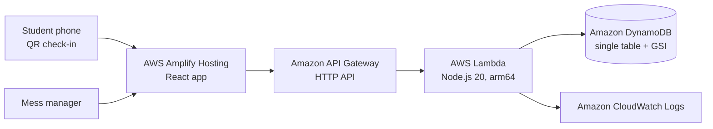

# MessWise

**Cook for the students who will actually eat.** Students confirm or skip a meal before a cutoff; the mess gets an explained cooking quantity; every meal's leftovers are weighed.

Bharat Builds Tour, Event 02: Environmental Hacks (WeMakeDevs × AWS) · Track 03: Waste and Energy

- Live app: `<AMPLIFY URL>`
- Demo video: `<VIDEO LINK>`
- Blog: `<BUILDER CENTER LINK>`

## The problem
<!-- One real number from the mess manager interview, e.g. "On a normal day about __ kg is left over." -->

## How it works
1. Mess manager creates a meal: cutoff time, buffer, dishes with grams per portion.
2. Students scan the QR on the mess door, enter their roll number once, tap **Eating** or **Skipping**.
3. The manager sees one number to cook, kg per dish, and the reason:

```
expected = confirmed + no_response × show_rate
portions = ceil(expected × (1 + buffer%))
kg_per_dish = portions × grams_per_portion / 1000
```
> "212 confirmed + 60 no-response × 40% expected show rate = 236. With a 5% buffer: 248 portions. Rice 31.0 kg, Dal 18.6 kg, Sabzi 24.8 kg."

4. At cutoff the number freezes (the API refuses check-ins and stores the final recommendation).
5. After the meal the manager logs portions served, leftover kg, and students unserved.
6. The show rate is learned per meal type and weekday once 3 real meals are logged; before that it is shown as an **assumption**.
7. If anyone goes unserved, the app warns and asks to raise the buffer. Saving food must never mean a student goes hungry.

## Built on AWS

Infrastructure is one AWS SAM template (`backend/template.yaml`), deployed with the open-source SAM CLI to `ap-south-1`.

## Pilot results
<!-- Real data only. Meal, students in group, recommended portions, served, leftover kg, unserved. -->

## Assumptions (shown in the UI too)
- Baseline kg per meal: what the mess says it usually cooks for the pilot group.
- LPG per kg cooked: figure from the mess manager.
- Cold-start show rate for students who don't respond: manager's estimate until learned.
- Rows marked *sample* on the impact page are seeded examples, not measurements.

## Run / deploy
```bash
# backend (AWS CloudShell has SAM preinstalled)
cd backend && sam build && sam deploy --guided   # region ap-south-1, set ManagerKey
npm test                                          # unit tests for the formula

# frontend
cd frontend && cp .env.example .env               # paste ApiUrl from sam output
npm install && npm run dev
```

## Limitations and honest notes
- Pilot covered one group of students over a weekend; numbers are not projected to the whole campus.
- Cutoff lock is enforced on the first request after cutoff rather than by a scheduler.
- Passcode auth for the manager only; no student accounts.

## What's next
- **WattWatch**: the same expected-vs-actual occupancy engine applied to empty classrooms drawing power.
- WhatsApp check-ins, multi-hostel warden dashboard, leftover alerts to nearby NGOs.

## Team
